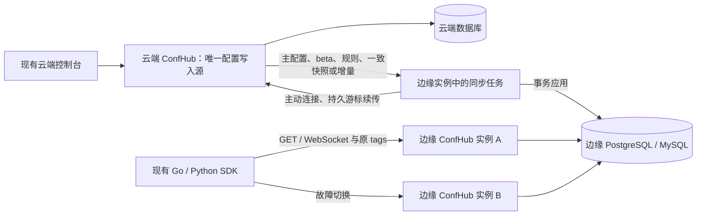

# 云边配置分发调研

调研日期：2026-10-13。本文保留当时的资料核实与设计推导；2026-10-14 用户确认后，已按 SQL 边缘及可替换消息通信实现，当前行为、部署与测试见 [云边说明](cloud-edge.md)。本文的“建议”与“可复用经验”属于针对 ConfHub 的设计判断，不代表参考产品提供同样的协议或保证。

## 初步结论

采用 **云端唯一写入与管理，边缘 ConfHub 使用本地 PostgreSQL/MySQL 保存配置及灰度规则，并在本地按原有客户端 tags 解析** 的模式。云端管理主配置、单份 beta 与有序规则，边缘为本地客户端提供读取及变更通知；断网时继续使用最后一次成功同步的状态，恢复后自动追平。带数据库的部署形态已经由用户确认，具体同步协议仍是设计建议。

“在云端实现灰度”需要区分管理位置与评估位置：灰度内容、规则和开关都由云端管理，但每次客户端读取不必请求云端评估。LaunchDarkly 服务端 SDK 的官方架构正是同步完整规则、本地评估；这为保留现有客户端标签和离线读取提供了参考。[L4]

用户已经明确：一期同步全部配置，灰度保持现有体验，只使用原客户端标签，不增加站点或区域灰度维度；不同区域使用不同配置。这里的“全部配置”仍应在实施设计中明确是全部**当前服务状态**，还是连主版本历史也复制。仅为边缘读取提供服务时，当前 main、beta、规则和配置元数据足够；管理历史与回退可以留在云端。这是建议边界，尚不能当作已确认范围。

## 参考方案比较

| 官方方案 | 权威与分发模式 | 评估或读取位置 | 离线能力与明确限制 | 对 ConfHub 的适用价值 |
| --- | --- | --- | --- | --- |
| LaunchDarkly Relay Proxy + 服务端 SDK | 云端管理；Relay 汇聚云端流，向局域网 SDK 分发；daemon 模式则由 Relay 更新共享持久存储 | 服务端 SDK 获取完整规则后本地评估；客户端 SDK 的架构不同，通常接收解析结果 | 在线模式缓存可以延续服务；是否能断网重启取决于持久化；专用 offline 模式使用导出文件，规则更新须重新下载并替换文件 | 最贴近“中央管理灰度、边缘根据原始标签解析”的分工，但它是特性开关体系，不能直接认定为任意配置与主版本历史的完整复制方案 |
| AWS AppConfig Agent | 云端管理与部署；Agent 异步轮询数据面，在本地缓存配置，通过 HTTP GET 服务应用 | 普通配置由本地缓存返回；多变体 feature flags 可按请求 Context 获取变体 | `BACKUP_DIRECTORY` 保存恢复用备份，`PRELOAD_BACKUPS` 控制启动载入；没有缓存且初次取云端失败会报错；普通 `writeTo` 文件不用于读取恢复 | 直接参考本地缓存、启动预取、断网重启与管理面/服务面分离；默认轮询和产品部署节奏不是 ConfHub 毫秒通知的依据 |
| Kubernetes API list/watch | API Server 为状态权威；客户端先读取一致集合快照，再从其 resourceVersion 订阅变更 | 客户端维护本地镜像，不包含配置灰度评估 | 可以从上次 resourceVersion 续传；历史过期返回 `410 Gone`，客户端重新 list/watch；分页快照保持同一 resourceVersion | 主要参考可靠镜像协议：快照与流之间无缝衔接、删除传播、游标过期后全量补偿；不是现成的云边配置中心 |

来源：LaunchDarkly [L1]–[L5]、AWS [A1]–[A6]、Kubernetes [K1]。

## 已核实的官方事实

### LaunchDarkly：代理并不等于远程评估

- Relay Proxy 是部署在用户基础设施上的 Go 程序，连接 LaunchDarkly streaming API，让多台服务连接局域网内的 Relay，从而减少跨网连接。[L1]
- **Proxy mode**：SDK 连接 Relay 的网络服务；多个 Relay 可以放在负载均衡后，节点之间不要求通信，没有主节点或集群。**Daemon mode**：服务端 SDK 直接读取 Relay 更新的同一个持久存储，需要客户端能访问存储；它不是让 SDK 请求 Relay 的另一种名字。[L2]
- 服务端 SDK 初始化时取得与其 SDK key 关联的完整 ruleset，在内存中执行评估算法，输入是当前 context；客户端 SDK 通常由 LaunchDarkly 解析并缓存 context 对应的结果。这两种数据模型不可混用。[L4]
- Relay 的在线服务是否能在无法连接云端时初始化，与是否使用持久存储有关：有存储可以读取此前 known-good 值；没有存储且尚未连接成功时不知道任何 flags，SDK 会使用 fallback。缓存 TTL 和存储故障也会影响可用性。[L5]
- **Offline mode** 是明确禁止 Relay 连接 LaunchDarkly、从本地导出文件读取 flags 与 segments 的专用模式。规则变化后必须重新下载文件并替换；Relay 自动检测并重新加载，无需重启。它不是在线模式遇到临时断网后自动同步追平的同义词，且仅对特定套餐开放。[L3]

可复用经验：中央编辑、本地解析、上行连接汇聚和持久状态恢复可以独立设计。ConfHub 无需采用 daemon 让业务 SDK 直连边缘数据库；保持现有 HTTP/WebSocket 协议，边缘自己解析规则更符合现有客户端接口。官方 Relay 文档并未在本次读取内容中给出可直接照搬的持久游标确认协议、全站多配置原子切换保证或配置历史复制保证，不能据此宣称已解决这些问题。

### AWS AppConfig Agent：缓存恢复与普通文件输出不同

- Agent 在本地维护内存缓存，通过本地 HTTP 服务返回配置，并在后台异步轮询 AWS AppConfig 数据面更新。默认首次请求才获取配置，因此首次请求更慢。[A1]
- 容器环境的 `PREFETCH_LIST` 可以启动时预取指定配置，`POLL_INTERVAL` 默认 45 秒；`REQUEST_TIMEOUT` 区分初次获取失败与后台刷新失败，后者记录错误并重试。[A2]
- `BACKUP_DIRECTORY` 保存配置备份到磁盘；`PRELOAD_BACKUPS=true`（默认）将备份载入内存，并立即检查云端新版本；为 false 时只在无法从服务获取配置时使用备份。备份未加密，文件权限需要保护。[A2]
- Manifest 的 `writeTo` 只是输出一份配置供读取文件的应用使用。官方明确说 Agent **不读取这些输出文件**，不能用它代替备份功能。[A3]
- AppConfig 支持云端受控部署与逐步发布；Agent 也支持请求携带 `Context` 获取多变体 feature flag。部署策略与 feature flag 的条件匹配是相关但不同的机制，不能直接对应 ConfHub 的有序 tag 规则和单份 beta。[A4][A5]
- `GetLatestConfiguration` 返回最新部署配置，没有变化时内容可能为空；每个 token 只能用于一次请求，后续必须用响应的新 token，token 最长有效 24 小时。这是该 API 的会话契约，**不是任意配置集合的持久变更序号或删除事件流**。[A6]

可复用经验：启动时是否具备可服务的本地状态要显式定义；内存缓存不能覆盖“断网且重启”的需求。预取全部已授权当前配置后，再开放就绪状态，可以避免客户端第一个请求才发现某个配置尚未复制。轮询间隔、磁盘格式和恢复路径应各自明确。AWS 资料没有在本次读取内容中承诺“跨多个配置的统一事务快照”或“删除资源立即从所有 Agent 缓存清除”；ConfHub 仍须自行设计并验证。

### Kubernetes list/watch：可靠恢复需要快照边界

- 获取集合时响应包含集合级 `resourceVersion`，随后 watch 从该版本之后追踪创建、更新和删除。断线可以从最后接收的 resourceVersion 重启 watch，也可以重新 list。[K1，Efficient detection of changes]
- 历史保存有期限，历史版本不可用时客户端必须识别 `410 Gone`，重新 list，并从新快照版本开始 watch。不能仅不断重试已过期游标。[K1]
- 分页读取使用 `limit` 与 `continue`，所有页保持相同集合 resourceVersion，因此中途创建、更新、删除不会让不同页混成不同时间的集合。分页 token 本身也会过期；过期时需要重读快照。[K1，Retrieving large results sets in chunks]
- Watch 的 `BOOKMARK` 表示截至指定 resourceVersion 的变更已发送，但客户端不能假定存在固定频率或一定收到 bookmark。[K1，Watch bookmarks]

可复用经验：云边同步需要“某个时间点完整状态 + 从这个点之后的变更”，而不是普通分页列表后随便建立一个通知连接。建议沿用该模式，但 ConfHub 的本地提交、持久游标和客户端通知时序要自己定义。Kubernetes resourceVersion 是其 API 的版本语义，不应被当成可随意执行加一运算的连续业务版本。

## 两类灰度分发方式

| 方式 | 复制内容 | 断网时遇到新客户端或新 tags | 云端连接与数据量 | 本需求判断 |
| --- | --- | --- | --- | --- |
| 复制原始服务状态 | 当前 main 内容、单份 beta 内容、全部有序规则、解析需要的元数据 | 边缘使用本地规则立即判断，规则变更待恢复同步后生效 | 每个边缘复制配置状态；无需为每个 tag 组合建立云端订阅 | 建议采用，符合“云端统一编辑、边缘读取与灰度保留原有体验” |
| 复制云端按 tags 解析后的结果 | 某些客户端或某些 tag 组合对应的已选配置 | 未见过的 tags 可能没有结果；需要回云端、预先枚举或额外 fallback | 需要跟踪客户端/组合；标签变化会增加订阅与失效状态 | 一期不建议，难以同时满足全部配置镜像和断网接入新客户端 |

这是由两种数据模型推导出的方案比较，不是参考产品替 ConfHub 做出的承诺。原始状态同步需要包含关闭规则、规则顺序与 beta 内容变化；即使主版本号未变化，规则调整和 beta 覆盖也必须形成同步变更。边缘解析应使用客户端原标签，不能把中继器向云端连接时的 IP 当成所有下游客户端 IP。

## 同步协议应明确的设计约束

以下是本调研提出的建议，不是已实现行为。持久化采用本地 PostgreSQL/MySQL；具体接口与数据库 HA 部署由后续设计决定。

1. **唯一权威。** 云端接受编辑、发布、回退、删除和规则变更；边缘的配置及规则只由复制流程更新。边缘断网后继续读，不引入离线编辑与双向冲突合并。
2. **先快照再变更。** 全量快照返回同一状态边界对应的游标，主内容、beta、规则作为配置聚合整体复制。分页或分片仍要保持这个边界；不能在逐页实时读取时漏掉期间的删除或编辑。
3. **持久化状态与游标一起提交。** 应用某次事件时，把配置状态和已应用游标写入同一持久提交；提交成功后再向下游推送。重启后使用已提交游标继续同步，重复事件可幂等处理；仅“网络收到”不代表本地已安全应用。
4. **快照替换原子可见。** 下载新快照时保留旧状态供读取，把新状态写入临时 generation/事务，校验完整后整体切换。失败或半途断网不能让客户端看到半份新快照。单个配置的 main、beta、规则更新也需要一个一致读取边界；一期不必因此承诺独立多次发布跨配置原子生效。
5. **游标失效必须可识别。** 云端说明可续传的最旧日志边界；游标过期则显式要求重新全量，而不是静默跳到最新事件。还应有云端数据世代/源标识，识别云端重建或指向另一个数据集，避免旧游标误用。
6. **删除是变更。** 增量事件包含删除标记；全量恢复必须替换集合或对不存在项执行清除，不能只 upsert。删除后重建同一名称也要可区分新状态。断网期间本地仍可能提供云端已删除的旧配置，这是继续离线服务的必然边界，恢复后应追平删除。
7. **失败与新鲜度分开。** 边缘有完整本地状态时云断连仍可读；没有成功快照或有效本地缓存时不能伪装为空配置集合。至少可查看最后成功同步时间、已应用游标、连接状态、错误和同步落后情况；“边缘存活”不等于“内容已是云端最新”。
8. **复制凭据与管理凭据分开。** 同步全部配置会复制配置里的敏感内容，边缘应使用专用只读机器身份，避免用管理员账号登录或携带普通业务客户端 tags 调用解析 API。授权撤销和删除在断网时无法立即作用于本地副本，这个边界需要明确。

## 来源与核实范围

以下链接均在本次调研中实际读取；读取日期为 2026-10-13。优先使用官方文档，未使用搜索摘要或第三方博客作为证据。GitHub 原始源码地址本次网络访问失败，因此本文关于 LaunchDarkly 的事实来自其官方产品文档，未声明完成源码验证。

- **[L1]** [LaunchDarkly：The Relay Proxy](https://launchdarkly.com/docs/sdk/relay-proxy)，Go Relay、云端流与局域网连接汇聚。
- **[L2]** [Configuring SDKs for the Relay Proxy](https://launchdarkly.com/docs/sdk/relay-proxy/sdk-config)，proxy/daemon、持久存储及缓存 TTL。
- **[L3]** [Offline mode](https://launchdarkly.com/docs/sdk/relay-proxy/offline)，离线文件、重新下载更新、限制及自动 reload。
- **[L4]** [Client-side, server-side, and edge SDKs](https://launchdarkly.com/docs/sdk/concepts/client-side-server-side)，完整规则集与解析结果的区别、服务端本地评估。
- **[L5]** [Relay Proxy guidelines](https://launchdarkly.com/docs/sdk/relay-proxy/guidelines)，持久存储初始化、缓存与存储故障行为。
- **[A1]** [AWS：What is AWS AppConfig Agent?](https://docs.aws.amazon.com/appconfig/latest/userguide/appconfig-agent.html)，本地缓存、HTTP GET 与异步更新。
- **[A2]** [Using environment variables to configure AWS AppConfig Agent for Amazon ECS and Amazon EKS](https://docs.aws.amazon.com/appconfig/latest/userguide/appconfig-integration-containers-agent-configuring.html)，备份、启动预载、预取、轮询和初次获取失败语义。
- **[A3]** [Configuring AWS AppConfig Agent to write configuration copies to disk](https://docs.aws.amazon.com/appconfig/latest/userguide/appconfig-agent-how-to-use-additional-features-write-to-disk.html)，明确区分文件输出与恢复用备份。
- **[A4]** [Working with deployment strategies](https://docs.aws.amazon.com/appconfig/latest/userguide/appconfig-creating-deployment-strategy.html)，逐步部署、实体部署及监控回退。
- **[A5]** [Retrieving basic and multi-variant feature flags](https://docs.aws.amazon.com/appconfig/latest/userguide/appconfig-integration-retrieving-feature-flags.html)，本地 Agent 的 Context 请求示例。
- **[A6]** [GetLatestConfiguration](https://docs.aws.amazon.com/appconfig/2019-10-09/APIReference/API_appconfigdata_GetLatestConfiguration.html)，一次性会话 token、有效期、空响应与下次轮询间隔。
- **[K1]** [Kubernetes API Concepts](https://kubernetes.io/docs/reference/using-api/api-concepts/)，list/watch、resourceVersion、`410 Gone`、bookmarks 与一致分页快照。

## 针对当前 ConfHub 的代码核实

以下事实来自本仓库当前源码，尚未实现云边功能。

| 现有能力或限制 | 代码依据 | 对云边实现的影响 |
| --- | --- | --- |
| 有序规则按原始 tags 匹配，所有命中指向同一 beta | [config.Resolve](../internal/config/routing.go)、[State/Effective](../internal/config/types.go) | 两种边缘都可复用同一个解析器，保持现有规则与 beta 语义 |
| HTTP GET 和 WebSocket 返回已解析后的 Effective，不包含完整 rules/beta 集合 | [clientGet](../internal/server/configs.go)、[Session.offer](../internal/syncer/session.go) | 不能直接使用现有业务 SDK 的 Get/Subscribe 来复制全部原始状态；需要专用云边 API |
| 变更日志只保存键、身份、序号、删除标记，当前配置读取是独立的可重复读事务 | [Changes](../internal/storage/events.go)、[Current](../internal/storage/configs.go) | 可复用日志作为变更索引，但不能把它当作已经包含正文的跨网复制日志 |
| namespace/group CRUD 未产生配置变更事件 | [organization.go](../internal/storage/organization.go) | 配置键中的 namespace/group 可照常复制；若还要精确镜像空目录，则需补组织事件或单独目录同步 |
| Hub 数据源只需 Current/Changes，但管理 Server 和启动代码绑定 SQL Store | [Source/Hub](../internal/syncer/hub.go)、[Server](../internal/server/server.go)、[main](../cmd/main/main.go) | 规则、缓存、会话可复用；轻量中继需要拆开管理启动与客户端服务，而非把完整 SQL 服务直接套进一个文件存储 |
| Hub 连续无法读取数据源时退出就绪并关闭连接 | [watchReadiness](../internal/syncer/hub.go) | 边缘 Hub 必须读取健康的本地镜像；云端连接异常只改变同步状态，不触发本地服务下线 |
| SDK 按 sequence 排序结果，磁盘缓存按服务地址与标签分区 | [Go SDK cache](../sdk/go/cache.go) | 边缘需要稳定的排序语义；重启不能重置序号，不能把独立边缘的不同序号空间混到同一地址池 |
| 现有在线客户端与标签建议只来自共享数据库中的本地会话记录 | [presence](../internal/storage/presence.go)、[clients API](../internal/server/clients.go) | 云端不会自动看见边缘终端 tags；若要求现有灰度表单补全体验，需要额外上报标签摘要 |

## 用户已确认的边界

- 云端是权威源，一期同步全部配置，区域之间使用不同配置。
- 灰度保持现有单机体验，只匹配原客户端 tags；不增加站点选择、区域灰度或额外规则类型。
- 边缘断云继续使用最后成功同步的状态提供服务；恢复后自动追平。
- 用户比较两种部署形态后，选择带本地数据库的边缘 ConfHub；一期不实现嵌入式存储中继器。

建议“一期同步全部配置”定义为所有配置的**当前服务状态**：配置身份、完整 namespace/group/name 键、当前主版本号与正文/格式、单份 beta、规则及顺序、用于去重的来源修订。历史版本、回退操作、用户权限和审计留在云端；云端回退后形成的新当前主版本仍会正常同步。空组织目录是否复制以及本地状态页范围仍是建议边界，未获得用户确认。

复制所有区域的配置并不自动限制某个区域读取其他区域配置；现有业务客户端协议没有读取鉴权。本期按“全部镜像”执行，不同时承诺区域权限隔离；如果后续需要按区域限制可见范围，则应另行设计同步范围与客户端权限。

## 两种边缘部署选择

这两种方案使用相同的云边同步协议与灰度解析语义，区别是本地持久化和部署方式。已选择左列的 SQL 方案，右列保留作方案比较。下文都是可实现的设计效果，不能视为当前已有功能。

| 对比项 | 边缘 ConfHub + 本地 PostgreSQL/MySQL | 轻量中继器 + 本地嵌入式持久化 |
| --- | --- | --- |
| 配置与灰度 | 同步当前主配置、beta、规则；按原 tags 解析 | 同样同步、同样解析，结果应一致 |
| 客户端接入 | 现有 HTTP GET/WebSocket；SDK 改为本地地址即可 | 实现相同协议；SDK 同样只改服务地址 |
| 云端断网 | 本地数据库健康且已有完整镜像时继续服务 | 本地数据文件健康且已有完整镜像时继续服务 |
| 断网时边缘重启 | 从本地数据库恢复 | 从嵌入式存储恢复；纯内存代理做不到这一点 |
| 本地写入 | 只允许同步程序写镜像；业务配置编辑在云端 | 只读客户端服务；同步程序是唯一镜像写入者 |
| 部署组成 | 应用容器加数据库；数据库也可以使用边缘现有服务 | 一个容器加持久卷，无独立数据库服务 |
| 边缘多实例 | 多应用共享本地数据库及镜像游标，适合复用现有广播与租约机制 | 每个实例使用独立文件与游标，分别向云同步；不直接共享一个文件做多写 |
| 状态查看 | 可逐步复用本地配置/客户端只读页，但须禁用配置管理写接口 | 一期可仅有健康、同步状态接口；完整控制台需要额外接入 |
| 资源与运维 | 有数据库固定开销、备份和升级工作；应用仍可使用有界缓存 | 服务数更少；需要嵌入式存储恢复、备份与容量治理，不能假定零内存开销 |
| 实现成本 | SQL、客户端服务和 HA 机制基础较多；仍要新增复制应用路径与只读模式 | 要实现 MirrorStore，拆开管理 Server；可复用解析器、Hub、Session 和客户端协议 |
| 主要风险 | 边缘数据库故障会影响所有共享它的应用，需要按需求提供数据库 HA | 单个容器/磁盘故障影响该节点；多副本的状态追平与地址切换必须定义 |
| 更适合 | 已有数据库、边缘需要多实例或完整运维能力 | 边缘只负责分发、低维护成本与单容器交付优先 |

带数据库的方案也需要云边复制协议，不能仅把云端数据库 DSN 填到边缘：那仍是远程读库，断云后本地服务会失去数据源。直接 PostgreSQL 物理复制或 MySQL 复制绑定数据库类型和运维模式，也无法自然满足两类后端及复制范围要求，故本调研优先建议应用层同步。

轻量方案建议评估嵌入式事务存储作为本地镜像，而非只写一个内存缓存或逐个覆盖 JSON 文件。其接口与现有 SQL 存储可以不同，只需支持读取当前状态、获取本地变更及原子应用复制批次。实现和测试应集中在这个边界，避免重写配置解析与客户端长连接。

两种方案可以放在同一仓库、共用客户端服务与同步模块，使用不同启动角色或构建入口。带数据库也不要求另开发一份灰度引擎；轻量中继也不要求依赖业务 SDK 来搬运已解析结果。

## 选定架构：带本地数据库的边缘 ConfHub

建议在同一项目和镜像中增加云端/边缘启动角色，通过 flag 与环境变量传入云端地址、专用同步凭据和本地数据库 DSN。复用现有 Go 服务、GORM、golang-migrate、灰度解析器与客户端协议，不另建一套规则引擎。



### 写入与服务边界

- 云端保留配置编辑、发布、回退、规则、多用户权限与审计。增加专用原始状态导出及变更同步 API。
- 边缘不开放配置、beta、规则和组织的管理写接口；一期建议仅提供客户端读取/订阅、健康与同步状态接口。边缘只读控制台作为后续功能，不需要先复制云端用户与审计。
- 每个边缘集群使用自己的本地数据库，同集群多个 ConfHub 实例共享该数据库。业务 SDK 连接这些实例，保持现有读取与订阅协议；同一地址池限于共享该数据库的实例。
- 配置主版本号、配置 ID、beta 和规则顺序保持云端原值。导入走专用存储路径，不能调用普通保存/规则管理接口制造额外主版本或伪造用户操作审计。同步过程可以另记运维日志。

### 多实例只运行一个同步写入者

建议以一个边缘数据库为单位，通过数据库租约选出活动同步任务，其他实例随时接管。租约使用数据库时间并附带递增的持有世代（fencing token）；每次应用批次在事务内锁定并校验租约及世代，使失去租约的旧任务无法继续提交。

现有 [维护租约](../internal/storage/maintenance.go) 固定使用清理任务的 `id=1`，没有 fencing token。它可作为数据库选主思路的参考，但同步任务需要独立的命名租约或表，不能与清理任务争用同一个租约。

状态更新、删除、已应用云端游标及本地变更事件必须在同一事务提交。所有服务实例通过现有本地变更流/Hub 感知提交并推送；不得在提交前直接推送，也不依赖只有同步任务所在实例收到内存通知。同步任务接管时从数据库中的已提交游标续传。

### 断网与故障行为

| 状态 | 边缘行为 |
| --- | --- |
| 初次部署，尚无完整镜像 | 不就绪；完成首个一致快照后才对外服务 |
| 已有完整镜像，云端断连 | 本地读与 WebSocket 继续服务；展示同步异常及最后成功时间 |
| 云端断连期间应用重启 | 从本地数据库恢复完整镜像和游标，继续服务并后台重连 |
| 云端恢复，游标仍有效 | 增量追平并通知本地客户端 |
| 云端恢复，游标已过期 | 保留旧镜像服务，下载完整快照；校验完成后整体替换并清除缺失项 |
| 一个边缘应用实例退出 | 同数据库其他实例继续服务，同步任务租约到期后接管 |
| 边缘数据库不可用 | 沿用本地存储故障的就绪及连接保护机制；不能把云断网可用性扩展为数据库故障可用性 |

多个应用实例不能消除本地数据库的单点故障。数据库 HA 可使用边缘现有设施或后续单独部署，一期应用层协议不绑定某一种数据库复制方案。

边缘主动建立上行连接，云端不要求能主动访问边缘。云边通信使用 TLS 和专用只读同步凭据；边缘不携带云端管理员 Cookie，不复制云端用户密码或 JWT 签名密钥。

例如云端某配置当前主版本 V8、beta 正文 B，规则为 `env=test`：同步到边缘后，`env=test` 客户端取得 B，其他客户端取得 V8。云端关闭规则后，同步成功的边缘将原 beta 客户端切回主版本；断云的边缘继续执行最后收到的旧规则。云端将主版本回退发布为 V9，边缘保存并通知 V9，无需在边缘重新执行一次回退。

## 一期同步协议建议

协议名称和具体 URL 待实现设计确定。下面说明行为约束，不预先新增接口。

### 首次全量

云端提供所有当前配置的一致原始快照和源水位。每个配置包包含主正文、beta、完整规则及身份；快照通过专用 API 导出，不通过普通配置 GET 枚举客户端解析结果。

云端快照与水位必须来自同一可重复读视图。大快照可以导出为不可变的临时分片/文件并有过期机制；分页必须绑定这个快照，不能每页新开事务实时读。边缘流式写入临时镜像，校验完成后切换活动镜像，不要求把全部正文加载到 RAM。边缘没有有效持久镜像时保持未就绪，不能对所有未复制配置返回正常 404。

### 后续增量与断网追平

根据后续讨论，建议将云边通信改为可注入的双向消息接口，不再将“WebSocket 通知 + HTTP 下载”固定在同步流程中。首次快照、增量请求/响应与水位通知都走同一个通信实例；WebSocket 或 NATS 负责具体传输。该接口提案尚未实现，也尚未确定一期必须交付哪些传输实现。

断线指数退避并带抖动；恢复后从**已持久应用**的水位继续。通知本身只提示有更新，不能当作已经复制或已应用。

一期可以复用现有日志索引，按如下闭合区间生成最终状态增量：

1. 云端在同一可重复读事务取得当前水位 `W`、已清理水位和边缘起点 `C`。
2. 找出 `(C,W]` 内**所有**受影响配置键，对这些键读取同一事务视图中的最新完整状态；不存在的键给出删除项。同一键多次变化允许合并为截至 W 的最终状态。
3. 将这些最终状态与 `through=W` 组成一个完整包；边缘事务提交正文、规则、beta、删除和源游标，之后才通知本地客户端。
4. 变更范围、键数量或包大小超过预算时，改做全量补偿。**不能截取前 N 条事件，却把游标推进到 W；不能逐个在不同时间读正文，却声称是 W 的完整镜像。**

该方案服务于“最终最新状态”，不要求恢复时回放每一次 beta 编辑或短暂中间版本。它避免把 beta 短期编辑记录改造成用户可查看的历史，同时也不需要将当前仅含元数据的 change_event 假装成正文日志。高更新量下若扫描索引成本不可接受，再评估专用持久复制日志、批次状态日志或导出优化。

空 namespace/group 当前没有配置事件。若一期仅服务客户端，可按配置键生成所需目录；若要求本地目录列表完整一致，需要将组织变化纳入同步协议，不能假设现有日志已经覆盖。

### 删除与全量补偿

日志游标早于保留水位（当前默认保留 24 小时）时，请求完整快照。完整快照成功切换后删除云端已不存在的本地配置；只做 upsert 会留下幽灵配置。普通增量中的旧键删除、新键创建或移动，以及同名重建都应同步身份变化并通知订阅者。

断网期间云端撤回灰度、删除配置或发布新正文不会立即改变离线边缘；这是“断网继续服务”的明确语义。恢复时自动追平最新状态，未经同步不声称云端发布已在该边缘生效。

### 云端游标与客户端序号

建议边缘将云端水位与本地发送序号分开保存：

- 云端水位用于获取下一批、检测过期和去重。
- 本地持久递增序号用于保持现有 SDK 的新旧排序，并由同一边缘共享数据集中的所有实例共同使用。
- 配置主版本号、beta、规则和配置 ID 仍来自云端，本地同步不生成新的业务主版本。

边缘崩溃或重启不允许重置本地发送序号。云端重建、备份恢复造成序号倒退或换到另一个源时，应显式识别来源与世代，不能静默接受。相关绑定/重建流程需要在实施时定义。

为了让现有 SDK 无需修改，一期建议一个 SDK 地址池只包含同一个边缘共享数据集的实例。带数据库的多实例容易满足；两个独立中继器的本地序号空间不同，**不能直接放入现有 SDK 的同一地址池并声称可靠故障切换**。若要支持多独立中继副本无缝切换，应另行采用共同来源序号契约或扩展 SDK 源世代比较；不能靠主版本号排序，beta 编辑和规则修改不会增加主版本号。

### 可替换的通信接口提案

用户希望同步流程只接收一个类似 reader/writer 的通信实例，可接入 WebSocket、NATS 等实现。建议使用保留消息边界的最小接口，避免将消息传输强行模拟成连续字节流：

```go
type Conn interface {
    Send(ctx context.Context, message []byte) error
    Recv(ctx context.Context) ([]byte, error)
    Close() error
}
```

同步流程接收 `Conn`，统一处理协议编解码、握手、来源身份、持久游标、快照、增量与提交确认。启动层创建传输实现并注入，不在同步流程内按协议类型分支。具体传输负责建立通信通道、认证、存活检测及消息收发；连接失败后由外层会话生命周期重新建立通信实例，再进行游标握手。恢复透明与否均不能跳过持久游标核对。

`io.ReadWriteCloser` 也可以表达双向通信，但需要另外定义消息长度、短读/短写处理及取消方式。这里既然支持 WebSocket/NATS，`Send/Recv` 更接近实际需求；未来若接 TCP，可在 TCP 实现内部处理分帧，上层接口仍相同。

接口契约必须与方法一起定义：

- 一次 Send/Recv 对应一条完整消息；可同时运行一个发送者和一个接收者，不要求支持多个发送者或多个接收者。
- Send 返回只代表当前发送操作成功，不代表对端已收到或已持久化；失败时交付结果可能不确定。需要确认时，由公共同步协议明确回复已提交游标。
- Recv 返回的数据归调用者持有，不能在后续接收时被实现覆盖；Send 调用期间调用者不得修改消息。
- context 取消必须能结束等待；Close 幂等并解除阻塞的收发。队列、待发送量和消息长度均有上限，满载应阻塞或返回错误，不能无限累积或静默丢弃数据包。
- 上层按来源身份、请求 ID、游标和快照分片序号校验，不依赖所有实现都提供可靠、有序或恰好一次交付。乱序、重复或缺块不得推进持久游标；无法恢复时重新建立同步会话。

公共消息种类建议限于握手/恢复请求、水位通知、快照请求/分片/完成、增量请求/分片/完成、已应用确认和错误。每个包有请求 ID，数据按共同的最大消息预算分片，完成标记携带范围与校验信息；接收完并校验之前不得切换快照或提交该批次游标。分片大小需满足所选传输的有效负载上限。调度应限制在途分片，避免大快照占满队列。

| 传输实现 | 如何满足共同接口 | 特别约束 |
| --- | --- | --- |
| WebSocket | 通过双向连接收发应用消息，首次快照与增量也可分片传输 | 心跳、读写超时、消息上限由实现处理；不要求另外部署消息服务器 |
| NATS | 为边缘同步会话建立请求/回复消息通道，把 subject 与订阅细节封装在实现中 | 每个边缘集群必须获得自己的更新，不可用一个共享 queue group 把更新分摊给不同边缘；配置认证和 subject 隔离 |

此表是实现提案，不表示已经验证特定 NATS 部署的交付保证。同步可靠性仍建立在云端持久状态/日志与边缘持久游标上；不能把 NATS 发布成功或 Broker 确认当作边缘已应用，也不要求一期引入 JetStream。连接恢复时必须主动核对云端水位；会话定期交换存活及水位信息，可发现最后一条通知丢失且此后没有新更新的情况，不依赖定时全量拉取。

建议先以 WebSocket 实现和内存双端实现验证公共接口，再实现 NATS。内存实现用于协议测试，不能代替 WebSocket/NATS 的真实连接、取消、容量和恢复集成测试。只有真实实现确有差异时再增加接口能力，避免先设计庞大的传输框架。

## 云端界面与运维

用户希望灰度管理保持单机体验，建议保留现有配置编辑、唯一 beta、规则开关、diff 确认与回退流程。变化只有这些操作的传播目标从云内实例扩展到了边缘镜像。

云端当前没有边缘终端会话数据，灰度表单的自定义标签和值补全不会自动出现。若这也是“相同体验”的范围，建议边缘定期上报去重的标签名/值摘要供云端补全；一期不必上传全部配置正文或全量在线客户端列表。摘要需要有条数/大小上限和过期时间，避免沿用已经断开的客户端标签。完整客户端列表、边缘订阅已发送版本和终端应用确认可以作为后续独立功能。

至少建议提供边缘同步状态：最近成功同步时间、源水位、已应用水位、在线/重连/追平/断云继续服务、是否有可用本地镜像。`/health/ready` 代表本地可服务，云断连只显示同步状态落后；本地存储损坏或没有完成初次快照才退出就绪。

云端发布响应成功不等于所有边缘已应用。WAN 延迟、带宽、断网和大快照传输均不在先前本机 300 ms 通知压测内；云→边缘→客户端需要新增测试，不能直接复用当前局域网数字作承诺。

## 实现顺序与必要验证

按已选择的 SQL 边缘形态，建议依次实施：

1. 定义原始配置聚合、来源身份/世代、快照和增量包、游标、专用同步认证与最小通信接口。
2. 实现公共同步协议和首个传输实现，提供云端一致快照导出、增量最终状态包及水位通知，覆盖删除与游标过期；同步逻辑不依赖具体传输库。
3. 增加边缘角色和专用 GORM 导入路径，由 golang-migrate 管理镜像游标、租约及快照暂存所需表结构。
4. 实现持久应用、原子快照切换、租约接管和本地变更广播；关闭边缘配置管理写入口。
5. 增加同步状态、断线重连、Docker Compose 云端/边缘示例和云边测试；标签摘要上报按是否纳入一期体验再确定。

验证至少覆盖：首次全量与并发编辑之间不漏变更；beta 覆盖和规则开关无主版本变化仍传播；删除/重建/批量移动；重复包及旧包晚到；提交前后崩溃；断云新客户端与边缘重启继续读取；超过 24 小时后的全量替换；大快照中断不暴露半镜像；云源更换/序号倒退；原 HTTP/双 SDK/WebSocket 灰度语义一致。多实例选择还要验证复制任务竞争、共享本地水位以及客户端故障切换。

本次确定带本地数据库的边缘 ConfHub，后续实现围绕该方案推进。主版本历史、空组织目录、本地只读控制台和云端标签补全的数据上报仍按上文的建议边界处理，不能把它们误标为已确认需求。
